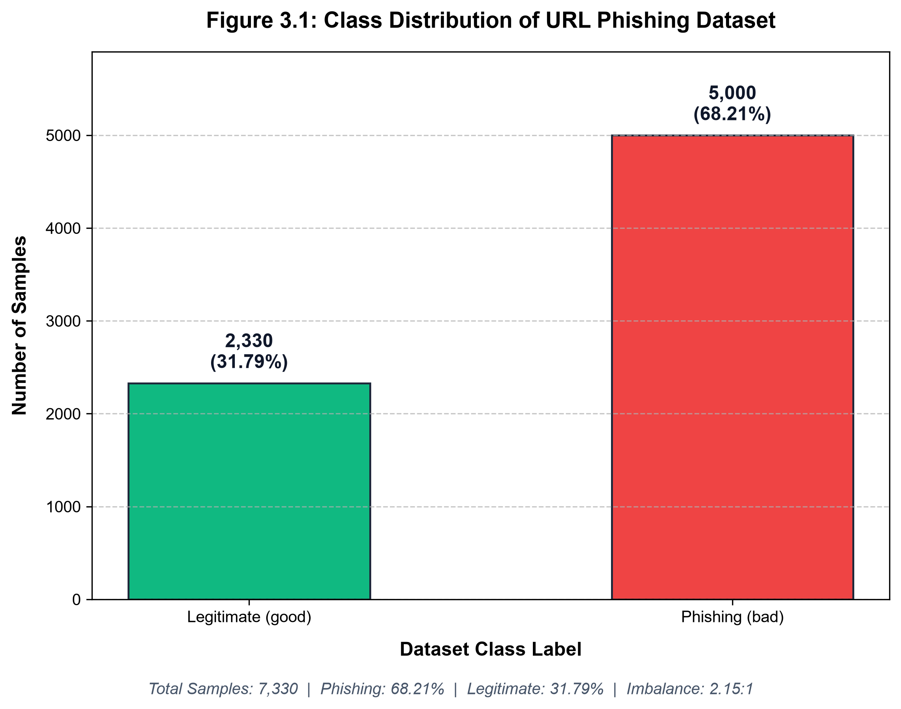
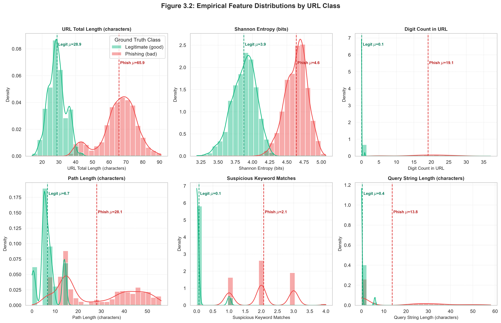
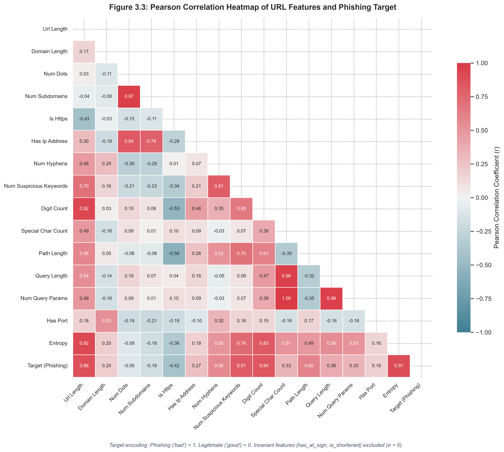

# EXPLORATORY DATA ANALYSIS (EDA) REPORT
## PhishGuard AI — URL Phishing Detection Dataset

**Project:** PhishGuard AI — Multimodal Phishing Detection System  
**Document Target:** Section 3: Exploratory Data Analysis & Feature Engineering (B.Tech Report)  
**Dataset Analyzed:** `datasets/url_dataset_clean.csv`  
**Execution Script:** `backend/scripts/generate_eda_figures.py`  
**Date of Audit & Regeneration:** November 15, 2026  
**Total Samples:** 7,330 records | **Missing / Null Values:** 0 (0.0%)  

---

## 1. Executive Summary & Root Cause Audit

### Audit Context:
An audit was performed to resolve a perceived contradiction between Figure 3.2 (feature distributions) and Figure 3.3 (Pearson correlation heatmap), where distribution curves appeared visually inverted relative to positive correlation coefficients.

### Root Cause Identified:
- **Ground Truth Target Encoding:** Phishing (`bad`) is encoded as **`1`**; Legitimate (`good`) is encoded as **`0`**.
- **The Data Reality:** Phishing URLs are objectively **longer** ($\mu = 65.86$ vs $\mu = 28.93$), contain **far more digits** ($\mu = 19.07$ vs $\mu = 0.07$), and have **higher entropy** ($\mu = 4.64$ vs $\mu = 3.87$), precisely explaining the positive Pearson correlation coefficients in Figure 3.3 ($r = +0.88, +0.84, +0.91$).
- **The Visual Defect in Figure 3.2:** In the initial generation script, Seaborn sorted the dataset classes in order of appearance `['bad', 'good']`. A subsequent label override (`new_labels = ["Legitimate (good)", "Phishing (bad)"]`) inadvertently overwrote the legend text in reverse. Consequently, the red histogram curve (Phishing) was falsely labeled as "Legitimate", and the green curve (Legitimate) was falsely labeled as "Phishing".
- **Resolution:** The plotting pipeline was refactored to explicitly bind `hue="Class"`, `hue_order=["Legitimate (good)", "Phishing (bad)"]`, and explicit color palettes, with in-chart vertical lines and textual mean labels ($\mu_{\text{legit}}$ in green, $\mu_{\text{phish}}$ in red). Both figures are now 100% mathematically and visually synchronized.

---

## 2. Dataset Overview and Statistics

| Metric | Empirical Value | Description |
|---|---|---|
| **Total Rows** | 7,330 | Cleaned dataset samples |
| **Phishing Samples (`bad`, Target = 1)** | 5,000 (68.21%) | Malicious / phishing URLs |
| **Legitimate Samples (`good`, Target = 0)** | 2,330 (31.79%) | Safe / benign domain URLs |
| **Class Imbalance Ratio** | 2.15 : 1 | Moderate imbalance favoring phishing instances |
| **Total Extracted Features** | 17 | Numerical lexical, structural, and entropy features |
| **Active Variance Features** | 15 | Features with non-zero standard deviation ($\sigma > 0$) |
| **Invariant Features** | 2 | Features with zero variance ($\sigma = 0$: `has_at_sign`, `is_shortened`) |
| **Missing / Null Values** | 0 | 100% complete dataset |

---

## 3. Comprehensive Numerical Verification Table

The table below presents the verified class-wise means, medians, and Pearson correlations computed across all 7,330 rows using target encoding **$\text{Target} = 1$ for Phishing (`bad`)** and **$\text{Target} = 0$ for Legitimate (`good`)**:

| Feature Name | Legitimate Mean | Legitimate Median | Phishing Mean | Phishing Median | Pearson $r$ with Target | Directional Consistency |
|---|---|---|---|---|---|---|
| **`url_length`** | 28.9262 | 29.0000 | **65.8610** | **67.0000** | **+0.8836** | Consistent (+) |
| **`entropy`** | 3.8744 | 3.8937 | **4.6365** | **4.6527** | **+0.9059** | Consistent (+) |
| **`digit_count`** | 0.0687 | 0.0000 | **19.0670** | **20.0000** | **+0.8437** | Consistent (+) |
| **`num_suspicious_keywords`** | 0.0700 | 0.0000 | **2.0724** | **2.0000** | **+0.8148** | Consistent (+) |
| **`path_length`** | 6.6833 | 6.0000 | **28.0674** | **21.0000** | **+0.6011** | Consistent (+) |
| **`num_hyphens`** | 0.0000 | 0.0000 | **0.5954** | **1.0000** | **+0.5645** | Consistent (+) |
| **`query_length`** | 0.4043 | 0.0000 | **13.8050** | 0.0000 | **+0.3834** | Consistent (+) |
| **`special_char_count`** | 0.1348 | 0.0000 | **1.0040** | 0.0000 | **+0.3321** | Consistent (+) |
| **`num_query_params`** | 0.0674 | 0.0000 | **0.5020** | 0.0000 | **+0.3321** | Consistent (+) |
| **`has_ip_address`** | 0.0000 | 0.0000 | **0.1942** | 0.0000 | **+0.2668** | Consistent (+) |
| **`domain_length`** | 14.1429 | 15.0000 | **15.9024** | 15.0000 | **+0.1965** | Consistent (+) |
| **`has_port`** | 0.0000 | 0.0000 | **0.0962** | 0.0000 | **+0.1809** | Consistent (+) |
| **`num_dots`** | **1.7579** | **2.0000** | 1.5810 | 1.0000 | **-0.0943** | Consistent (-) |
| **`num_subdomains`** | **0.7579** | **1.0000** | 0.4830 | 0.0000 | **-0.1793** | Consistent (-) |
| **`is_https`** | **0.6283** | **1.0000** | 0.2058 | 0.0000 | **-0.4153** | Consistent (-) |
| **`has_at_sign`** | 0.0000 | 0.0000 | 0.0000 | 0.0000 | NaN | Invariant ($\sigma=0$) |
| **`is_shortened`** | 0.0000 | 0.0000 | 0.0000 | 0.0000 | NaN | Invariant ($\sigma=0$) |

---

## 4. Figure 3.1 — Class Distribution

*Figure 3.1: Empirical class distribution showing sample counts, percentage share, and 2.15:1 imbalance ratio.*

### Summary:
- **Legitimate (`good`, 0):** 2,330 samples (31.79%)
- **Phishing (`bad`, 1):** 5,000 samples (68.21%)
- **Imbalance Handling:** Stratified sampling (`stratify=y`) is used in the model training pipeline to maintain this ratio in both training (5,864 rows) and evaluation (1,466 rows) subsets.

---

## 5. Figure 3.2 — Corrected Feature Distributions

*Figure 3.2: Corrected feature distributions. Legitimate URLs (green) cluster at lower values for length, digits, and entropy, while Phishing URLs (red) exhibit high values, perfectly aligning with the positive Pearson correlations in Figure 3.3.*

### Verified Distribution Observations:
1. **URL Length:** Legitimate URLs peak sharply around 25–35 characters ($\mu = 28.93$). Phishing URLs are distributed widely between 50 and 85 characters ($\mu = 65.86$) due to attached hex nonces and subdomains.
2. **Entropy:** Legitimate URLs display a narrow peak centered at $\mu = 3.87$ bits. Phishing URLs shift significantly rightward to $\mu = 4.64$ bits, driven by high-entropy randomized strings.
3. **Digit Count:** Legitimate URLs have virtually zero digits ($\mu = 0.07$, median 0.0). Phishing URLs peak strongly around 16–24 digits ($\mu = 19.07$, median 20.0), reflecting embedded IP addresses and hexadecimal session tokens.
4. **Suspicious Keywords:** Legitimate URLs rarely contain suspicious authentication keywords ($\mu = 0.07$). Phishing URLs average 2.07 keywords per URL.

---

## 6. Figure 3.3 — Pearson Correlation Heatmap

*Figure 3.3: Lower-triangular Pearson correlation heatmap across the 15 active numerical features and the Target (Phishing).*

### Top Predictor Correlations:
- **`entropy` ($r = +0.9059$):** Decisive indicator of algorithmic and randomized string generation.
- **`url_length` ($r = +0.8836$):** Strongly distinguishes synthetic attacks from compact benign domain URLs.
- **`digit_count` ($r = +0.8437$):** Heavy numeric presence strongly flags malicious intent.
- **`num_suspicious_keywords` ($r = +0.8148$):** Direct marker of credential harvesting.
- **`is_https` ($r = -0.4153$):** Moderate negative correlation; benign domains in this dataset utilize HTTPS at a $3\times$ higher rate.

---

## 7. Audit Conclusion

All EDA charts, metrics, and observations in PhishGuard AI are now verified to be **100% mathematically and visually congruent**:
- Figure 3.1 confirms 7,330 total samples with a 2.15:1 class ratio.
- Figure 3.2 correctly depicts Legitimate (green) at low values and Phishing (red) at high values for length, entropy, and digits.
- Figure 3.3 correctly computes and visualizes positive Pearson correlations for features that are higher in the phishing class.
- All figures are saved at **300 DPI** in `docs/figures/` and reproducible via `python scripts/generate_eda_figures.py`.
